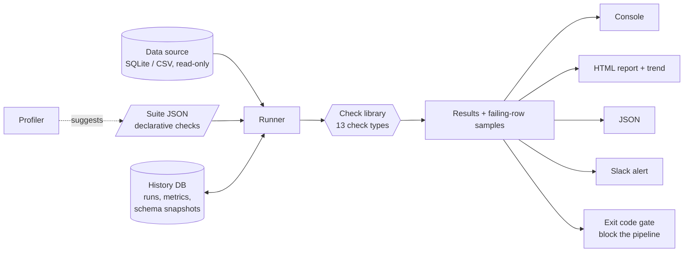

# dqmon: Data Quality & Monitoring Framework


A **config-driven data quality framework** that automatically detects **missing values, duplicates,
invalid records and schema inconsistencies**, then goes further and *monitors* data over time:
volume anomalies, null-rate drift, schema drift and freshness, with HTML/JSON reports, run history
and alerting. A failing check can block your pipeline through the CLI exit code.

> **Stack:** Python 3.10+ (standard library only) · SQL · SQLite · pytest · GitHub Actions · Docker

Think of it as a small, readable cousin of Great Expectations / Soda / dbt tests, built from scratch
to show how these tools work under the hood.

## Try it in 30 seconds

```bash
git clone https://github.com/YOUR-USERNAME/dq-monitor && cd dq-monitor
make demo           # or: PYTHONPATH=src python -m dqmon demo
```

The demo simulates **three days** of an e-commerce dataset that degrades:

| Day | What happens | What dqmon catches |
|---|---|---|
| 1 | Healthy baseline | Gate **passes**, baselines recorded |
| 2 | "Bad deploy" | 16% missing emails, duplicate order IDs, invalid statuses, negative amounts, orphan `customer_id`s, new column added |
| 3 | "Upstream outage" | Row volume **-60%**, data **3.5 days stale**, `amount` silently became `TEXT` |

Open `demo_output/report_day3.html` for the report (a pre-built copy is in [`docs/`](docs)).

Real output from day 3 (trimmed):

```
  FAIL  not_null:customers.email             76 of 520 rows (14.62%) have a missing email
  FAIL  unique:orders.order_id               48 of 824 rows (5.83%) share a duplicate order_id
  FAIL  referential_integrity:orders.customer_id  17 of 824 rows (2.06%) are orphans (no matching customers.customer_id)
  FAIL  freshness:orders.order_date          latest order_date = 2025-02-28 (3.5 days old, limit 1.5)
  FAIL  row_count_anomaly:orders             824 rows vs median 2055.5 of last 2 runs (-59.9%, limit +/-30%)
  FAIL  schema_drift:orders                  type changed: 'amount' REAL -> TEXT
  WARN  null_rate_drift:customers.email      null rate 14.6% vs baseline 8.2% (+6.4 pp, limit +5 pp)
  ...
  Quality score: 45.8% | blocking issues: 9 | warnings: 4
  GATE: FAILED
```

## Architecture



## Check catalog

| Dimension | Check type | Detects |
|---|---|---|
| **Completeness** | `not_null` | NULL **and blank** values (with optional tolerance) |
| **Uniqueness** | `unique` | Duplicate keys, single or composite |
| **Validity** | `allowed_values`, `range`, `regex` | Bad categories, out-of-range numbers, malformed formats |
| **Consistency** | `referential_integrity`, `custom_sql` | Orphan foreign keys, any business rule you can write as SQL |
| **Schema** | `schema` | Contract violations: missing columns, wrong types |
| **Freshness / volume** | `freshness`, `row_count` | Stale tables, empty tables |
| **Monitoring (history-aware)** | `schema_drift`, `row_count_anomaly`, `null_rate_drift` | Changes vs previous runs: new/dropped/retyped columns, volume spikes/drops, rising null rates |

Every check supports `severity` (`error` blocks the pipeline, `warn` only reports) and row-level checks
support `max_fail_pct` for tolerated failure rates. Every failure includes **sample failing rows**.

### Example suite

```json
{
  "name": "ecommerce_orders",
  "source": {"type": "sqlite", "path": "warehouse.db"},
  "checks": [
    {"type": "unique", "table": "orders", "column": "order_id"},
    {"type": "not_null", "table": "customers", "column": "email", "max_fail_pct": 1},
    {"type": "allowed_values", "table": "orders", "column": "status",
     "values": ["pending", "shipped", "completed", "cancelled", "returned"]},
    {"type": "referential_integrity", "table": "orders", "column": "customer_id",
     "ref_table": "customers", "ref_column": "customer_id"},
    {"type": "freshness", "table": "orders", "column": "order_date", "max_age_days": 1.5},
    {"type": "row_count_anomaly", "table": "orders", "max_change_pct": 30},
    {"type": "schema_drift", "table": "orders"}
  ]
}
```

## Usage

```bash
# Run a suite against a SQLite file (or --csv-dir for a folder of CSVs)
python -m dqmon run suites/ecommerce.json --db my.db --html report.html --json report.json

# Auto-generate a starter suite by profiling your data
python -m dqmon profile --db my.db --out suites/starter.json

# Past runs and quality-score trend
python -m dqmon history

# Slack alerts: set DQMON_SLACK_WEBHOOK (or --slack-webhook); use --show-alert for a dry run
```

**Use as a pipeline gate:** `dqmon run` exits **1** when an error-level check fails
(`--fail-on warn` is stricter, `--fail-on never` is report-only):

```bash
python -m dqmon run suites/orders.json --db warehouse.db && ./publish_dashboard.sh
```

## Design decisions

- **Declarative, not procedural.** Checks are JSON, so analysts can add rules without touching Python.
  Bad configs fail fast with a message naming the offending check.
- **Monitoring needs memory.** Each run stores results, per-column null rates, row counts and schema
  snapshots in a history DB. Anomaly checks compare against the **median of recent runs** (robust to a
  single bad day), and observations are recorded *after* checks run, so a run never judges itself.
- **Failures are debuggable.** Every failed check carries sample rows, and the report shows them.
- **Safe by construction.** Source databases open **read-only**; identifiers from config are validated
  (no SQL injection through a suite file); values use bound parameters; HTML output is escaped.
- **A broken check never kills the run.** Exceptions become an `error` result, and checks that can't
  be evaluated yet (no history) are `skipped`, not falsely green.
- **Severity separates blocking from informational**, with an optional tolerance, because real data is never perfect.
- **Profiler bootstrap.** `profile` writes a starter suite from today's data; a test proves the
  generated suite passes on its own data *and* fails when the data is corrupted.

## Project structure

```
src/dqmon/
├── checks.py      # 13 check types (the core library)
├── suite.py       # JSON -> check objects, with validation
├── runner.py      # executes a suite, records history
├── history.py     # runs / metrics / schema snapshots
├── metrics.py     # row counts, null rates
├── profiler.py    # data profiling + starter suite generation
├── reporters.py   # console, JSON, self-contained HTML report
├── alerts.py      # Slack payload + webhook
├── connectors.py  # read-only SQLite, CSV-directory sources
├── demo.py        # 3-day degrading dataset generator
└── cli.py         # run | profile | history | demo
suites/ecommerce.json   tests/   docs/   .github/workflows/ci.yml
```

## Testing

`make test` (46 tests) covers: every check type passing and failing, tolerance and sampling, SQL-injection
and read-only safety, suite validation, history-based anomaly/drift detection (including that a bad run
doesn't poison its own baseline), the full 3-day scenario, HTML escaping, JSON/Slack output, the
profiler round-trip, CSV sources and CLI exit codes.

## Roadmap

- Pluggable connectors: Postgres, BigQuery, Snowflake (checks already compile to plain SQL)
- Statistical anomaly detection (z-score / seasonality) and distribution-drift checks (PSI)
- Run as an Airflow task / dbt post-hook, and publish reports to S3
- Check result trend dashboard (Metabase / Streamlit) on top of `dq_history.db`
